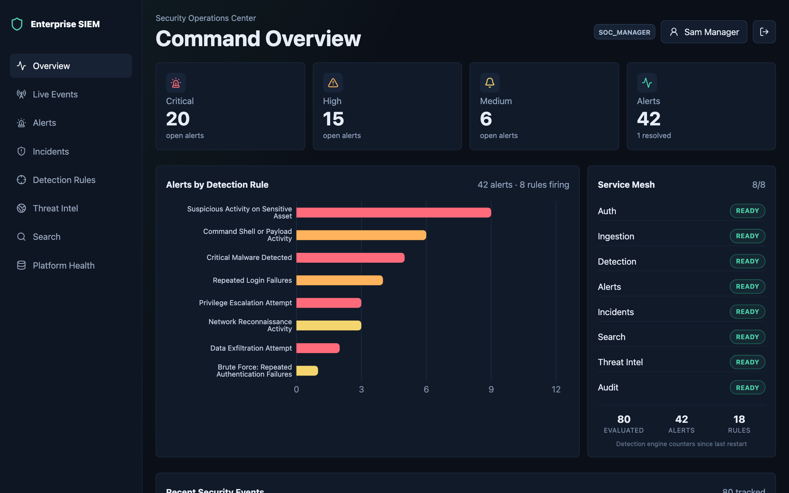
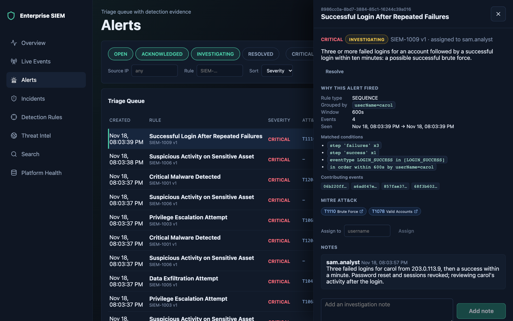
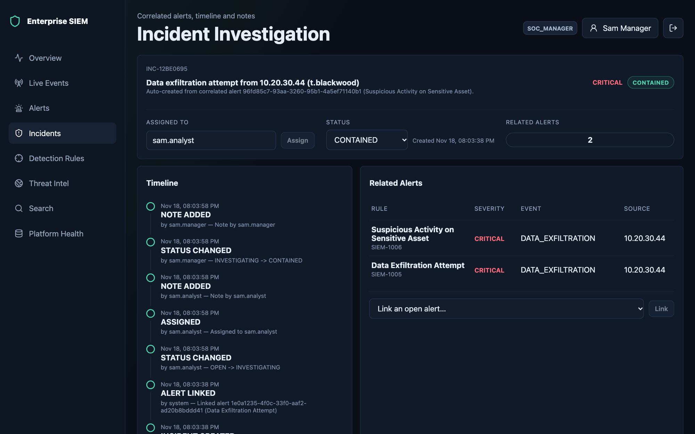
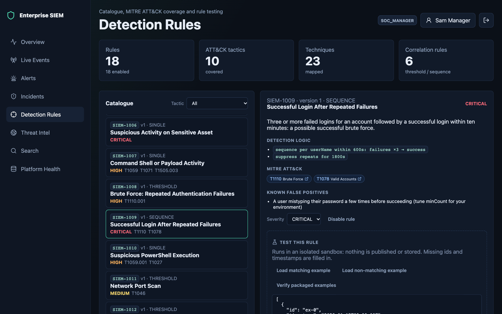
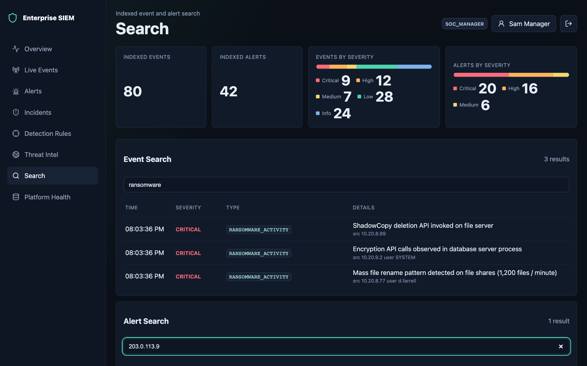
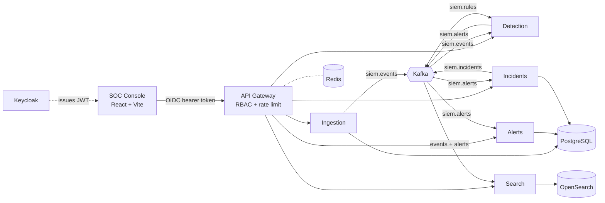

# Enterprise SIEM

**An event-driven Security Information and Event Management platform built as Spring Boot microservices.**
Security events are ingested through an authenticated gateway, streamed over Kafka, evaluated by a live-tunable rules engine, triaged as alerts and correlated into incidents. A React SOC console runs the whole workflow.




## Highlights

- **Reliable pipeline.**
  - Ingestion writes each event and an outbox row in one transaction, so accepted events reach Kafka even through broker outages.
  - Every consumer is idempotent, and poison records go to dead-letter topics.
- **Correlation detection engine.** 18 versioned rules across `SINGLE`, `THRESHOLD` and `SEQUENCE` types:
  - Threshold rules cover counts, distinct values, sums and periodic beaconing.
  - Detections cover brute force, success-after-failures, encoded PowerShell, port scans, exfiltration volume, C2 beaconing, EICAR/malware, log clearing, privileged-group changes and admin bursts.
  - Every rule maps to MITRE ATT&CK, documents its false positives, and ships examples that CI replays.
- **Explainable alerts.** Each alert stores the rule version, ATT&CK techniques and *evidence*: the clauses that matched, the group, the window and the contributing events. The console shows this as "Why this alert fired".
- **Rule sandbox.** Analysts can replay events through any rule in an isolated engine before trusting it in production (`POST /api/rules/test`).
- **Triage and investigation.**
  - Alerts: server-side filtering and paging, plus assignment and notes. History is append-only.
  - Incidents: correlated by source IP under an advisory lock, with a timeline and a status lifecycle.
- **Threat intel without fabrication.** Analysts curate the indicators (IP, domain, MD5/SHA1/SHA256), and every event is checked against them for sightings. No external feeds; the demo seed is labelled as simulated.
- **Central audit trail.** Rule changes, alert workflow and incident lifecycle land in an append-only, database-enforced audit log.
- **Defense in depth.**
  - Keycloak OIDC, plus RBAC at both the gateway and each service, tested cell by cell.
  - Rate limiting and request-size limits.
  - Correlation IDs, a CSP, a least-privilege database role and non-root containers.
- **Delivery.**
  - CI: unit and Testcontainers tests, 18 Playwright UI tests, CodeQL, gitleaks and Trivy, on SHA-pinned actions.
  - Deployment: gated through a protected `production` environment.

## Screenshots

| Alert triage | Incident investigation |
|---|---|
|  |  |
| **Detection rules** | **Search & analytics** |
|  |  |

## Architecture



Each domain service keeps a bounded in-memory read model. Writes go to PostgreSQL first and only then update memory, and the read model is rehydrated from the database on startup. More detail is in [docs/architecture.md](docs/architecture.md).

## Quick Start

Prerequisites: Docker with about 6 GB of memory available to it. To build outside Docker you also need Java 21, Maven 3.9 and Node 20+.

```bash
cp .env.example .env          # then replace every change-me value
docker compose up -d --build  # 17 containers; first build takes a few minutes
scripts/ingest-demo-events.sh # push 38 sample events through the pipeline
scripts/ingest-demo-events.sh sample-data/v2-attack-scenario.json  # simulated intrusion: fires 10 v2 rules
```

[docs/demo.md](docs/demo.md) walks through the scenario page by page.

Open **http://localhost:15173** and sign in as `admin` with the `SIEM_DEMO_PASSWORD` from your `.env`.

| Service | URL |
|---|---|
| SOC console | http://localhost:15173 |
| API gateway | http://localhost:18080 |
| Keycloak admin | http://localhost:18088/admin |
| Grafana | http://localhost:13000 |
| Prometheus | http://localhost:19090 |
| Mailpit (local inbox) | http://localhost:18025 |

All ports bind to `127.0.0.1` in a dedicated range, so the stack doesn't clash with a local Postgres or other dev servers. Every port can be changed in `.env`; see [docs/deployment.md](docs/deployment.md).

### Demo accounts

| User | Role | Can do |
|---|---|---|
| `admin`, `sam.admin` | `ADMIN` | Everything |
| `sam.manager` | `SOC_MANAGER` | Everything analysts can, plus rule changes, indicators and the audit log |
| `sam.analyst` | `SECURITY_ANALYST` | Events, alert and incident investigation |
| `sam.viewer`, `demo` | `VIEWER` | Read-only view of every page except the audit log; all writes refused |

`demo` uses `SIEM_PUBLIC_DEMO_PASSWORD`, intended to be shared publicly; every other account uses the private `SIEM_DEMO_PASSWORD`. Accounts lock temporarily after 5 failed sign-ins.

**Forgot password:** use the link on the sign-in page. Keycloak sends the reset email to a local [Mailpit](https://mailpit.axllent.org/) inbox at http://localhost:18025, so no real mail is sent.

## Detection Rules

| Category | Rules | ATT&CK |
|---|---|---|
| Brute force / credential access | `SIEM-1002`, `SIEM-1008` (≥5 failures/5 min per IP), `SIEM-1009` (failures → success) | T1110, T1078 |
| Execution | `SIEM-1007`, `SIEM-1010` (encoded / download-cradle PowerShell) | T1059, T1059.001, T1027 |
| Privilege escalation & admin activity | `SIEM-1003`, `SIEM-1017` (privileged group add), `SIEM-1018` (admin burst) | T1068, T1098, T1136 |
| Discovery | `SIEM-1004`, `SIEM-1011` (≥15 distinct ports/min) | T1046 |
| Exfiltration | `SIEM-1005`, `SIEM-1012` (≥500 MB to public IPs/hour) | T1041, T1048, T1567 |
| Command and control | `SIEM-1013` (periodic beaconing), `SIEM-1014` (uncommon ports) | T1071.001, T1573, T1571 |
| Malware | `SIEM-1001`, `SIEM-1015` (EICAR/known-bad hash) | T1204, T1204.002, T1486 |
| Defense evasion | `SIEM-1016` (audit log cleared) | T1070.001 |

Full logic, false positives and examples: [docs/detection-rules.md](docs/detection-rules.md). Rules live in [`detection-rules.json`](backend/detection-service/src/main/resources/detection-rules.json).

## Security Design

| Concern | Approach |
|---|---|
| Authentication | Keycloak OIDC with PKCE for the console. Every service validates the signature, issuer and `aud: api-gateway`. |
| Authorization | Role-based access enforced twice: route rules at the gateway and again inside each service. |
| Abuse protection | Redis token-bucket rate limit per user. Brute-force lockout in Keycloak. Bean Validation and a 2 MB body limit at the gateway and in every service; batches capped at 500 events. |
| Pipeline integrity | Transactional outbox, idempotent consumers, dead-letter topics for poison records, row locks on workflow transitions. |
| Accountability | Actor taken from the JWT. Rule, alert and incident changes reach an append-only audit log (`GET /api/audit/events`). |
| Secrets & exposure | No default credentials (Compose refuses to start without them). All ports are loopback-only. Containers run as non-root, and `.env` is excluded from builds. |

The local stack keeps Kafka on PLAINTEXT, OpenSearch with its security plugin off and Keycloak in dev mode. That is acceptable only because they're unreachable from outside this machine. [docs/security.md](docs/security.md) and [docs/threat-model.md](docs/threat-model.md) cover what changes for a shared deployment.

## Tech Stack

| Layer | Technology |
|---|---|
| Services | Java 21, Spring Boot 4.1, Spring Cloud Gateway, Spring Security, Spring Kafka, JDBC, Flyway |
| Messaging & data | Apache Kafka (KRaft), PostgreSQL 16, OpenSearch 2.15, Redis 7 |
| Identity | Keycloak 26 (OIDC, PKCE, realm roles) |
| Frontend | React 19, TypeScript, Vite, TanStack Query, Recharts, Playwright |
| Operations | Docker Compose, Prometheus, Grafana, Helm chart, Kubernetes manifests |

## Project Structure

```text
backend/
  api-gateway/                  Edge routing, OIDC, RBAC, rate limiting
  ingestion-service/            POST /api/events -> siem.events
  detection-service/            Rules engine, rule API, siem.rules
  alert-service/                Alert lifecycle, assignment, notes
  incident-service/             Correlation, incident timeline and workflow
  search-service/               OpenSearch indexing and query API
  threat-intelligence-service/  Indicators, sightings (matches every event)
  audit-service/                Append-only audit log from siem.rules / siem.audit / siem.incidents
  auth-service/                 Keycloak integration facade
  common/                       Shared models and security helpers
frontend/siem-dashboard/        React SOC console
infrastructure/                 Dockerfiles, Keycloak realm, Prometheus, Grafana, Helm, Kubernetes
sample-data/                    Simulated events: 38 v1 events + a v2 attack scenario
scripts/ingest-demo-events.sh   Token + batch ingest helper
docs/                           Architecture, API, deployment, operations, security
```

## Development

```bash
mvn clean verify                                    # build + ~196 backend tests incl. Testcontainers (Java 21, Docker)
cd frontend/siem-dashboard && npm ci && npm run dev   # console on http://localhost:15173 against the Compose backend
npx playwright install chromium && npm run test:e2e   # 18 UI tests against a mocked gateway
```

## Documentation

- [Architecture](docs/architecture.md): services, event flow and data ownership
- [API reference](docs/api.md): every endpoint and the roles it needs
- [Deployment](docs/deployment.md): ports, configuration and Helm
- [Production](docs/production.md): HTTPS deployment to a single server with Caddy
- [Operations](docs/operations.md): verification checklist and troubleshooting
- [Detection rules](docs/detection-rules.md): logic, ATT&CK mapping, false positives, sandbox testing
- [Security](docs/security.md) (RBAC matrix, hardening) and [threat model](docs/threat-model.md)
- [Demo walkthrough](docs/demo.md): a scripted attack scenario through the whole pipeline
- [v2 baseline audit](docs/audits/v2-baseline.md): the state of the project before this upgrade

## Roadmap

- Shared correlation state (e.g. Kafka Streams or Redis) so threshold/sequence rules scale across detection instances
- Kafka SASL/TLS with ACLs and the OpenSearch security plugin for multi-host deployments
- Opt-in, clearly attributed external threat-intel feeds (e.g. abuse.ch) with expiry
- Audit export to WORM object storage

## License

[MIT](LICENSE)
