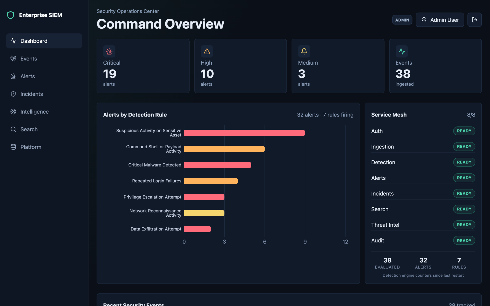
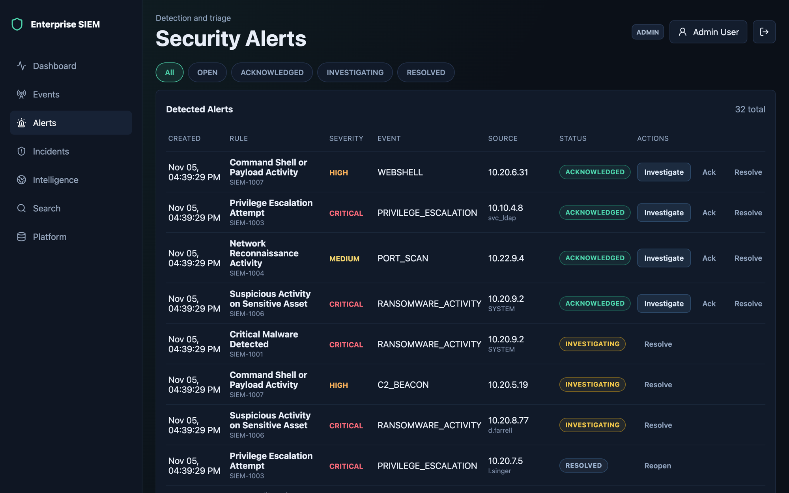
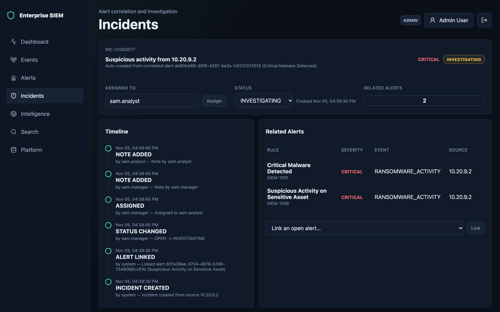
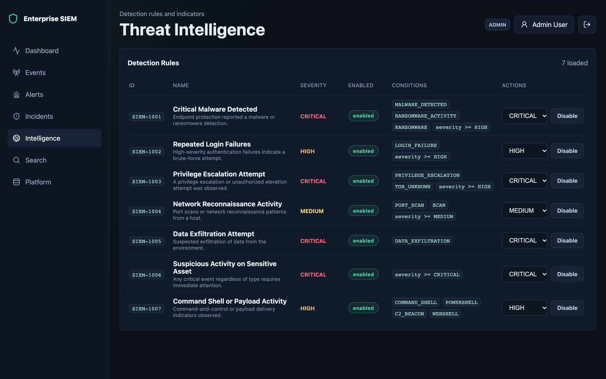
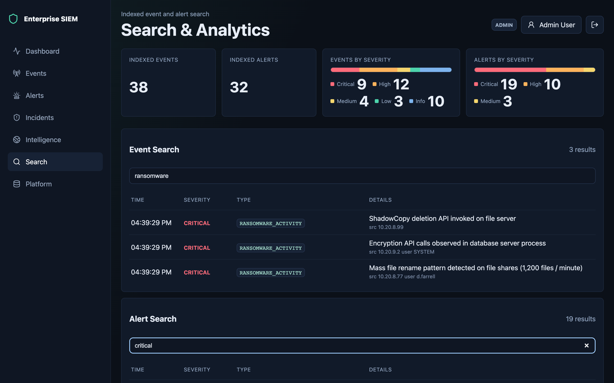
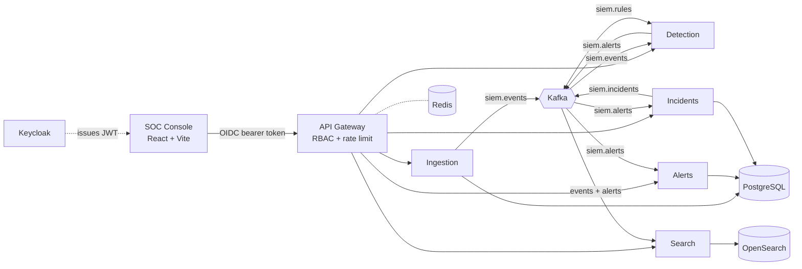

# Enterprise SIEM

**An event-driven Security Information and Event Management platform built as Spring Boot microservices.**
Security events are ingested through an authenticated gateway, streamed over Kafka, evaluated by a live-tunable rules engine, triaged as alerts and correlated into incidents. A React SOC console runs the whole workflow.




## Highlights

- **Streaming detection pipeline.** Ingestion publishes to `siem.events`. A rules engine with 7 packaged rules (malware, brute force, privilege escalation, reconnaissance, exfiltration, shells/C2) emits alerts to `siem.alerts`.
- **Live rule management.** Analysts can enable, disable or re-grade rules from the console. Each change is published to `siem.rules`, applied on every detection instance, replayed on restart and logged with the actor who made it.
- **Alert triage workflow.** Alerts move through `OPEN → ACKNOWLEDGED → INVESTIGATING → RESOLVED` with reopen. Transitions are enforced atomically on the server, and analysts can assign alerts and add notes.
- **Incident correlation.** Alerts sharing a source IP are grouped into incidents, each with a timeline, status lifecycle, assignee, notes and manual alert linking.
- **Search and analytics.** OpenSearch-backed full-text search and severity aggregations across events and alerts.
- **Zero-trust edge.** Keycloak OIDC with audience-bound JWTs, role checks at both the gateway and every service, and Redis token-bucket rate limiting.
- **Observability.** Micrometer metrics on every service, plus Prometheus scraping and a provisioned Grafana dashboard.

## Screenshots

| Alert triage | Incident investigation |
|---|---|
|  |  |
| **Detection rules** | **Search & analytics** |
|  |  |

## Architecture



Each domain service keeps a bounded in-memory read model. Writes go to PostgreSQL first and only then update memory, and the read model is rehydrated from the database on startup. More detail is in [docs/architecture.md](docs/architecture.md).

## Quick Start

Prerequisites: Docker with about 6 GB of memory available to it. To build outside Docker you also need Java 21, Maven 3.9 and Node 20+.

```bash
cp .env.example .env          # then replace every change-me value
docker compose up -d --build  # 17 containers; first build takes a few minutes
scripts/ingest-demo-events.sh # push 38 sample events through the pipeline
```

Open **http://localhost:15173** and sign in as `admin` with the `SIEM_DEMO_PASSWORD` from your `.env`.

| Service | URL |
|---|---|
| SOC console | http://localhost:15173 |
| API gateway | http://localhost:18080 |
| Keycloak admin | http://localhost:18088/admin |
| Grafana | http://localhost:13000 |
| Prometheus | http://localhost:19090 |

All ports bind to `127.0.0.1` in a dedicated range, so the stack doesn't clash with a local Postgres or other dev servers. Every port can be changed in `.env`; see [docs/deployment.md](docs/deployment.md).

### Demo accounts

| User | Role | Can do |
|---|---|---|
| `admin`, `sam.admin` | `ADMIN` | Everything |
| `sam.manager` | `SOC_MANAGER` | Events, alerts, incidents, rule changes |
| `sam.analyst` | `SECURITY_ANALYST` | Events, alert and incident investigation |
| `sam.viewer` | `VIEWER` | Read-only alert visibility |

All demo users share `SIEM_DEMO_PASSWORD`. Accounts lock temporarily after 5 failed sign-ins.

## Detection Rules

| Rule | Name | Fires on |
|---|---|---|
| `SIEM-1001` | Critical Malware Detected | `MALWARE_DETECTED`, `RANSOMWARE_ACTIVITY` ≥ HIGH |
| `SIEM-1002` | Repeated Login Failures | `LOGIN_FAILURE` ≥ HIGH |
| `SIEM-1003` | Privilege Escalation Attempt | `PRIVILEGE_ESCALATION`, `TOR_UNKNOWN` ≥ HIGH |
| `SIEM-1004` | Network Reconnaissance Activity | `PORT_SCAN` ≥ MEDIUM |
| `SIEM-1005` | Data Exfiltration Attempt | `DATA_EXFILTRATION` |
| `SIEM-1006` | Suspicious Activity on Sensitive Asset | Any event ≥ CRITICAL |
| `SIEM-1007` | Command Shell or Payload Activity | `COMMAND_SHELL`, `POWERSHELL`, `C2_BEACON`, `WEBSHELL` |

Rules are defined in [`detection-rules.json`](backend/detection-service/src/main/resources/detection-rules.json).

## Security Design

| Concern | Approach |
|---|---|
| Authentication | Keycloak OIDC with PKCE for the console. Every service validates the signature, issuer and `aud: api-gateway`. |
| Authorization | Role-based access enforced twice: route rules at the gateway and again inside each service. |
| Abuse protection | Redis token-bucket rate limit per user. Brute-force lockout in Keycloak. Bean Validation on every request body, and batch ingestion is capped at 500 events. |
| Pipeline integrity | Malformed Kafka records are logged and skipped instead of stalling consumers, and failed processing is retried. |
| Accountability | Rule changes, incident timeline entries and analyst notes record the authenticated user. |
| Secrets & exposure | No default credentials (Compose refuses to start without them). All ports are loopback-only. Containers run as non-root, and `.env` is excluded from builds. |

The local stack keeps Kafka on PLAINTEXT, OpenSearch with its security plugin off and Keycloak in dev mode. That is acceptable only because they're unreachable from outside this machine. [docs/security.md](docs/security.md) and [docs/threat-model.md](docs/threat-model.md) cover what changes for a shared deployment.

## Tech Stack

| Layer | Technology |
|---|---|
| Services | Java 21, Spring Boot 3.4, Spring Cloud Gateway, Spring Security, Spring Kafka, JDBC |
| Messaging & data | Apache Kafka (KRaft), PostgreSQL 16, OpenSearch 2.15, Redis 7 |
| Identity | Keycloak 26 (OIDC, PKCE, realm roles) |
| Frontend | React 19, TypeScript, Vite, TanStack Query, Recharts |
| Operations | Docker Compose, Prometheus, Grafana, Helm chart, Kubernetes manifests |

## Project Structure

```text
backend/
  api-gateway/                  Edge routing, OIDC, RBAC, rate limiting
  ingestion-service/            POST /api/events -> siem.events
  detection-service/            Rules engine, rule API, siem.rules
  alert-service/                Alert lifecycle, assignment, notes
  incident-service/             Correlation, incident timeline and workflow
  search-service/               OpenSearch indexing and query API
  auth-service/ audit-service/ threat-intelligence-service/   Service scaffolds for upcoming features
  common/                       Shared models and security helpers
frontend/siem-dashboard/        React SOC console
infrastructure/                 Dockerfiles, Keycloak realm, Prometheus, Grafana, Helm, Kubernetes
sample-data/                    38 demo security events
scripts/ingest-demo-events.sh   Token + batch ingest helper
docs/                           Architecture, API, deployment, operations, security
```

## Development

```bash
mvn clean verify                                   # build + 32 backend tests (needs Java 21)
cd frontend/siem-dashboard && npm ci && npm run dev  # console on http://localhost:15173 against the Compose backend
```

## Documentation

- [Architecture](docs/architecture.md): services, event flow and data ownership
- [API reference](docs/api.md): every endpoint and the roles it needs
- [Deployment](docs/deployment.md): ports, configuration and Helm
- [Operations](docs/operations.md): verification checklist and troubleshooting
- [Security](docs/security.md) and [threat model](docs/threat-model.md)

## Roadmap

- External threat-intelligence feeds for indicator enrichment (threat-intel service)
- Append-only audit trail service backed by `siem.incidents` and rule-change events
- Kafka SASL/TLS and OpenSearch security for shared deployments

## License

[MIT](LICENSE)
